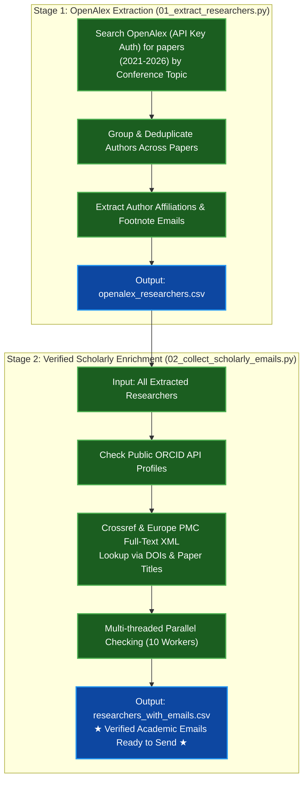

---

## The 2-Step Production Pipeline

### **Stage 1: Candidate Discovery & Extraction**
* **File:** `01_extract_researchers.py`
* **What it does:**
  1. Queries the OpenAlex Works API (with your API key) for papers in your conference topics.
  2. Extracts author metadata: names, OpenAlex IDs, ORCID links, and universities.
  3. Deduplicates authors across multiple papers into unique researcher records.
  4. Parses paper affiliation strings for publisher-printed corresponding author emails.
* **Output:** `openalex_researchers.csv`

---

### **Stage 2: Verified Scholarly Enrichment**
* **File:** `02_collect_scholarly_emails.py`
* **What it does:**
  1. Preserves existing emails from Stage 1.
  2. Queries the **ORCID Public API** for verified public profile emails (100% genuine).
  3. Queries **Crossref & Europe PMC full-text XML** by DOIs and titles.
  4. Multi-threaded processing finishes thousands of researchers in 2–3 minutes.
* **Output:** `researchers_with_emails.csv`

---

## How to Run for Any Conference

```powershell
# Step 1: Extract candidate researchers from OpenAlex
python 01_extract_researchers.py

# Step 2: Enrich with verified scholarly emails
python 02_collect_scholarly_emails.py
```

