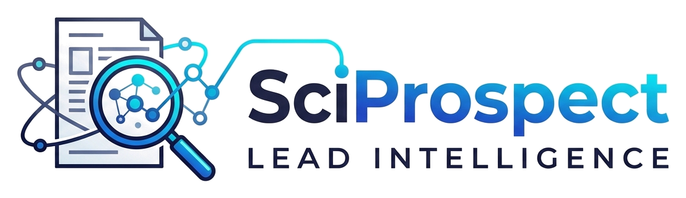

# SciProspect — Official Brand Identity & Logo Assets

Welcome to the brand identity assets package for **SciProspect (Lead Intelligence)**.

---

## 📁 Included Assets Overview

| Filename | Format | Description | Transparency |
| :--- | :--- | :--- | :--- |
| **`sciprospect_icon.svg`** | **Vector SVG (Source File 1)** | Standalone research document & magnifying discovery lens icon with scholar network data nodes. Fully scalable vector format. | ✅ Transparent |
| **`sciprospect_logo.svg`** | **Vector SVG (Source File 2)** | Full horizontal logo lockup: icon on left, connected data line flowing into `SciProspect` at top, and `LEAD INTELLIGENCE` subtitle below. | ✅ Transparent |
| **`sciprospect_icon_transparent.png`** | **High-Res PNG** | 512 × 512 px standalone icon badge. Ready for favicons, app shortcuts, social profiles, and docks. | ✅ Transparent |
| **`sciprospect_logo_transparent.png`** | **High-Res PNG** | 1108 × 321 px full horizontal brand lockup. Perfect for website headers, pitch decks, PDFs, and documentation. | ✅ Transparent |

---

## 🎨 Design Concept & Visual Metaphor

1. **Research Publication Document (`📄`)**: Symbolizes the academic literature, OpenAlex works, PubMed papers, and clinical NIH grant proposals.
2. **Magnifying Discovery Lens (`🔍`)**: Represents the precision search, prospecting engine, and Scholarly email extraction mechanism.
3. **Scholar Network Nodes**: Highlights the inter-connected co-authors, Principal Investigators (PIs), and verified researcher leads.
4. **Data Pipeline Bridge**: The cyan circuit line seamlessly connects the research paper data nodes directly into the modern `SciProspect` typography, illustrating data flow from academic repositories into verified leads.
5. **Subtitle Tracking**: `LEAD INTELLIGENCE` in bold, wide-spaced executive capital lettering.

---

## 💻 How to Use

- **In Web / HTML**:
  ```html
  <!-- Standalone Icon -->
  

  <!-- Full Horizontal Lockup -->
  
  ```
- **In Vector Design Tools**: Import `sciprospect_logo.svg` or `sciprospect_icon.svg` directly into **Figma**, **Adobe Illustrator**, **Canva**, or **Inkscape** for infinite lossless scaling.
